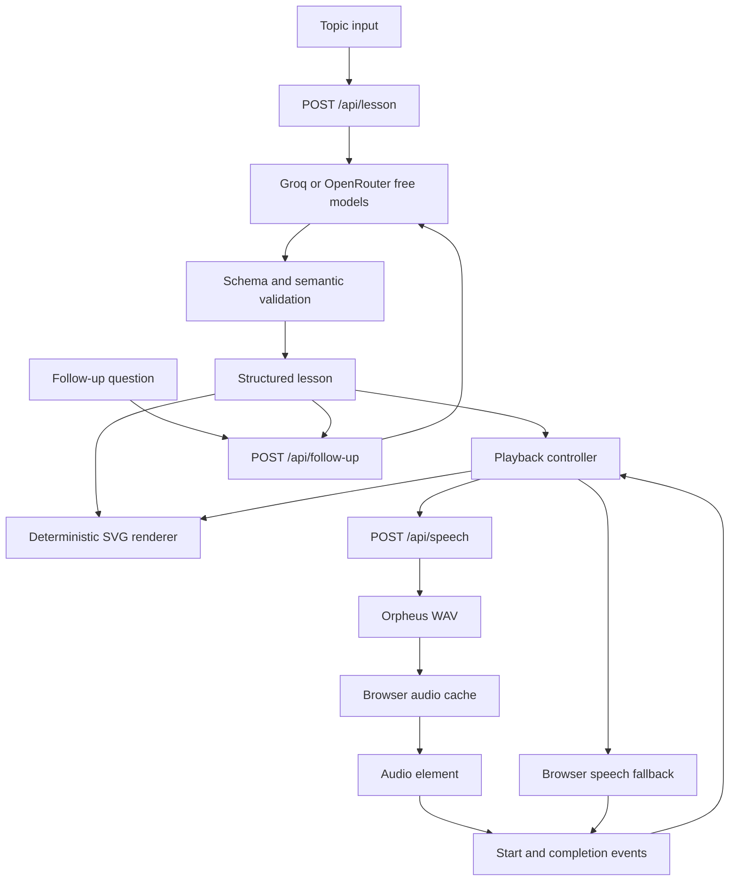

# Chalk — AI Whiteboard Tutor

A small visual tutor for curious beginners. Enter a topic, watch a roughly two-minute lesson with narrated diagrams, revisit a teaching step, and ask a contextual follow-up.

Built for the Braynix Studios technical assignment. The goal is to make the explanation and whiteboard share one structured lesson, so playback remains understandable and deterministic.

Built with Next.js 16, React 19, TypeScript, Tailwind CSS 4, and Zod. Lessons and follow-ups use Groq with an optional OpenRouter fallback; narration uses Groq Orpheus with browser speech fallback.

## Run locally

Use Node.js 24 LTS (Node 22.12+ also supported) and npm.

```sh
npm ci
cp .env.example .env.local
# Add your provider keys to .env.local, not to source code.
npm run dev
```

Open http://localhost:3000. Create a free key at [Groq Console](https://console.groq.com/keys). Keep the account on its free plan; this project does not require a paid subscription.

For independent lesson/chat failover, also create a free [OpenRouter key](https://openrouter.ai/settings/keys) and add `OPENROUTER_API_KEY` to `.env.local`. Restart the server after changing environment variables. The default chain is **Groq → OpenRouter Particle-1 free model**. Missing keys are skipped; either key alone can power text generation. Orpheus AI voice still uses the Groq key.

For AI voice, the Groq account owner must also accept the [Orpheus model terms](https://console.groq.com/playground?model=canopylabs%2Forpheus-v1-english) once. Until this is done, narration automatically uses browser speech. Accepting the model terms is separate from enabling paid billing.

Without a key, **Explore a sample lesson** still lets you inspect diagrams and playback. The sample content is explicitly prewritten. AI speech will fall back to browser speech when the server is unconfigured. Fresh lesson generation and follow-up answers require a working key; the application never substitutes the sample for a live response.

## Configuration

| Variable             | Default / purpose                                                                              |
| -------------------- | ---------------------------------------------------------------------------------------------- |
| `GROQ_API_KEY`       | Primary lesson/chat provider and AI voice; server only                                         |
| `GROQ_MODEL`         | `openai/gpt-oss-120b`                                                                          |
| `GROQ_TTS_MODEL`     | `canopylabs/orpheus-v1-english`                                                                |
| `GROQ_TTS_VOICE`     | `troy`                                                                                         |
| `OPENROUTER_API_KEY` | Independent free lesson/chat backup; server only                                               |
| `OPENROUTER_MODEL`   | `particle-ai/particle-1:free`; only an explicit `:free` model or `openrouter/free` is accepted |

For `GROQ_MODEL`, use a content model that supports Groq strict JSON-schema output and `reasoning_effort`. The default OpenRouter model was verified with a live structured lesson. You can set `OPENROUTER_MODEL=openrouter/free` to let OpenRouter select a free model, although latency and output quality vary across that pool. The code rejects paid OpenRouter model IDs and does not configure any paid fallback. The speech endpoint and audio validation are designed for Orpheus WAV output.

Never prefix secrets with `NEXT_PUBLIC_`. Environment files, build artifacts, and deployment credentials are ignored by Git.

## What works

- Chat-first topic entry with validated, real AI lesson generation.
- Four scenes with incremental SVG diagrams, highlights, equations, and numeric plots.
- AI narration by default; a persistent AI/browser voice preference.
- Automatic browser fallback on voice quota, timeout, unavailable service, or unusable audio.
- Play, pause, resume, step seeking, restart, and replay.
- Contextual follow-up chat and clickable diagram concepts.
- One understanding check with feedback generated as part of the lesson.
- Versioned restoration of the latest lesson in the same browser tab.
- Responsive layout, keyboard-operable controls, captions, reduced motion, and clear error states.

## Architecture



### Separation of concerns

- `src/lib/lesson.ts`: shared schema, semantic validation, deterministic board reconstruction.
- `src/lib/layout.ts`: diagram positions, connectors, and text wrapping.
- `src/lib/playback.ts`: framework-independent controller with injected speech adapters.
- `src/lib/speech-cache.ts` and `speech-adapters.ts`: browser effects, request pacing, audio caching, and speech engines.
- `src/lib/server/`: provider requests, bounded bodies, errors, and best-effort throttling.
- `src/app/api/`: the three server endpoints.
- `src/components/`: tutor conversation, player UI, and whiteboard rendering.

### Lesson and diagram generation

The LLM returns semantic content, not executable code, HTML, or raw SVG. Strict output is validated again with Zod; semantic checks catch unknown references, invisible highlights, duplicate IDs, scene backtracking, unused nodes, oversized narration, and invalid plots. The server adds the lesson ID and live-source label.

The provider schema constrains structure and lists content bounds as guidance. Zod enforces those bounds after generation, with one corrective retry if needed. Individual narration segments can be short; the complete lesson must still contain 200–320 words and every segment must fit the voice API's size limit. Provider JSON-validation failures participate in that retry instead of appearing as a generic service outage.

The model chooses a flow, cycle, comparison, or axes layout. Code places the nodes so the model does not need to invent pixel coordinates. This deliberately small visual vocabulary is a trade-off for predictable layout and simple code. A plotted curve is a model-generated teaching example, not a symbolic math solver.

### Free-provider failover and quota use

Lesson generation and follow-ups use the same provider router. It tries Groq first, then OpenRouter when Groq is rate limited, unavailable, misconfigured, or returns unusable output. Groq has an 18-second attempt budget and OpenRouter has 25 seconds, both bounded by the request's overall timeout. OpenRouter reasoning is disabled to keep the free fallback responsive. Model refusals are returned directly rather than sent to another provider.

Provider cooldowns preserve `Retry-After` and skip exhausted providers until they recover. If every configured provider is limited, the API returns the earliest known cooldown and the interface shows a countdown before enabling another attempt. There are no repeated background generation attempts.

Up to ten successfully validated lessons are cached per server instance for thirty minutes. Reusing a completed topic avoids another LLM call. Failed lessons are not cached; text casing is preserved in cache keys. Provider logs record success/failover without credentials or prompt contents. Caching and cooldown tracking are best-effort within a server instance, not durable coordination across a serverless fleet.

Free limits count provider requests and tokens, including unsuccessful generations, corrective retries, and manual development tests—not completed lessons. Independent providers reduce interruptions but cannot guarantee unlimited availability. Keep Groq on its free plan. OpenRouter is restricted to `openrouter/free` or `:free` models and has its own quotas. See [OpenRouter's free router](https://openrouter.ai/docs/guides/routing/routers/free-router) and [limits](https://openrouter.ai/docs/api_reference/limits).

### Synchronization and seeking

Each teaching step contains a short narration and node reveal/highlight IDs. There is one active speech source. The controller advances on actual speech completion, rather than a timer approximating voice speed. The board is ready for the selected step while audio loads; it never progresses independently of the selected narration.

The slider **seeks between teaching steps**, not arbitrary seconds. Reconstructing state from lesson data makes backward seeking and replay reliable. AI audio pause preserves its exact position. Browser speech uses native pause/resume, with current-step replay if the platform no longer reports an active utterance. Voice changes restart the current step and preserve whether playback was paused.

Generation IDs invalidate stale callbacks. A pending request cannot resume a paused lesson, and an old engine's completion cannot advance a new engine. Autoplay rejection is shown as a request to press Play, not as a provider outage.

### Voice quotas and caching

Orpheus currently accepts **up to 200 characters per request** and returns WAV audio. Chalk limits each narration step to 180 plain-text characters and makes one request per step. It prefetches only one step, deduplicates pending work, and spaces request starts by at least 6.5 seconds in a client session. Successful clips remain in memory for seeking and replay; no audio storage service is required.

Groq documents a baseline free Orpheus quota of **10 requests/minute, 100 requests/day**, with additional token limits. These apply across the account; several full lessons can consume the day's quota. Check the actual limits in your account. Client pacing and per-instance throttling are not global quota coordination.

If the active request fails, browser speech starts that step. If a prefetch fails, the current audio finishes before the browser engine starts the next step. The switch remains active for the lesson unless the learner explicitly retries AI voice; cooldowns from the server are respected. The saved preference remains AI. Voice quality and availability depend on the browser and OS; some browser voices may themselves use network services.

Browser speech **cannot generate a new lesson or answer a question** when the content LLM is unavailable. Those operations show an honest error and preserve existing lesson content.

References: [Groq structured outputs](https://console.groq.com/docs/structured-outputs), [Orpheus documentation](https://console.groq.com/docs/text-to-speech/orpheus), [Groq quotas](https://console.groq.com/docs/rate-limits), [browser speech](https://developer.mozilla.org/en-US/docs/Web/API/SpeechSynthesis).

## API contracts

| Route                 | Input                                                                                    | Success              |
| --------------------- | ---------------------------------------------------------------------------------------- | -------------------- |
| `POST /api/lesson`    | `{ topic: string }`, 2–180 characters                                                    | Validated `Lesson`   |
| `POST /api/speech`    | `{ text: string }`, 1–180 plain-text characters                                          | Binary `audio/wav`   |
| `POST /api/follow-up` | Topic, narration steps, current step, current labels, up to six prior messages, question | `{ answer: string }` |

Errors use `{ error: { code, message, retryAfter } }`. Rate-limit responses preserve a provider-supplied cooldown. Invalid inputs are rejected before making a provider call. Generation uses a total 45-second budget, tries available providers in order, and allows at most one corrective generation attempt; speech has a 15-second upstream timeout and no automatic retries.

## Tests and checks

```sh
npm run typecheck
npm test
npm run build
npx playwright install chromium
npm run test:e2e
```

Unit tests exercise schema boundaries, deterministic board state, playback races, voice switching, quota fallback, request pacing, cancellation, cache reuse, and server error handling. Browser tests use explicit test-only API and speech mocks for deterministic controls and conversation tests; they do not claim to verify real AI output or audible speech.

Before submission, test at least five fresh topics using a real key (for example: photosynthesis, binary search, supply and demand, the Pythagorean theorem, and an unfamiliar topic). Listen to the complete narration in Chrome and Safari, test mobile layouts, and inspect factual accuracy, diagram usefulness, duration, seeking, fallback, and follow-ups. The target is approximately 100–150 seconds, depending on the selected voice.

GitHub Actions runs type checks, unit tests, a production build, and mocked Chromium tests without an API key.

A manual live check simulated a Groq 429 while making a real request to `particle-ai/particle-1:free` through the production lesson handler. The backup returned a validated 12-step, 222-word lesson in about 15 seconds. Live checks use free API quota and are separate from the automated test suite.

## Deploy on Vercel

1. Push this directory as the root of your own public GitHub repository.
2. Import the repository into a Vercel Hobby project; keep the detected Next.js settings.
3. Add `GROQ_API_KEY` and `OPENROUTER_API_KEY` to the project's server environment. Add other variables only when overriding defaults.
4. Deploy, then verify the URL in an incognito window. Make sure deployment protection does not require reviewers to sign in.
5. Update the links below and submit both through the company’s Google Form.

The deployed server makes its own HTTPS requests to the configured providers. It does not depend on a local service, filesystem cache, or your development machine.

**Live demo:** Not deployed yet — local-first implementation.

**GitHub repository:** [SridharSahu-1/chalk](https://github.com/SridharSahu-1/chalk).

**Submission:** [Braynix Studios Google Form](https://docs.google.com/forms/d/e/1FAIpQLSdFJoTxMEuFZrCHTbEgv7bbg2uLf33SjP7n0w2qUONR4kMRcA/viewform).

## Privacy, limitations, and trade-offs

- No login or database. The latest lesson is stored in this tab's session storage; explicit voice preference is in local storage. Follow-up history and audio clips stay in memory. Starting a new lesson removes the previous saved lesson.
- Topics, lesson context, and questions are sent to Groq or OpenRouter and its selected model provider. Completed teaching content can remain in the server's bounded memory cache for thirty minutes. Do not submit sensitive personal information. Consult each provider's data policies for production use.
- Server credentials are never included in browser responses. Errors omit raw provider details. Logs contain status codes, not lesson text or credentials.
- Request-size limits, origin checks, and per-instance throttling reduce accidental abuse. They are not a distributed security or quota system. A larger public launch would need durable rate limiting and shared caching.
- AI explanations and numeric examples can be wrong. Output validation verifies structure, not truth. The app is an educational demonstration, not authoritative advice.
- Diagram layout is intentionally constrained; complex graphs and long mathematical notation are outside this version's scope. English is the supported narration language.
- Free API quotas and hosting limits can change. Keep both accounts on their free plans and recheck live access before evaluation.
- Real provider integration, OS voice quality, and Safari behavior require manual verification with a configured key. Mocked tests cannot establish those results.
